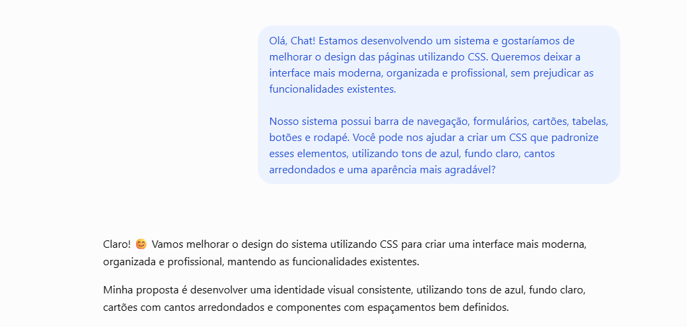
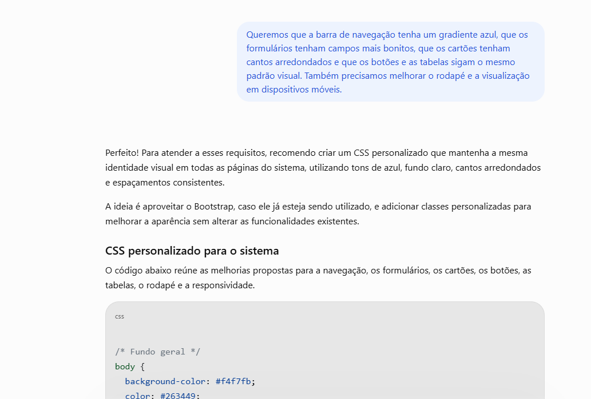
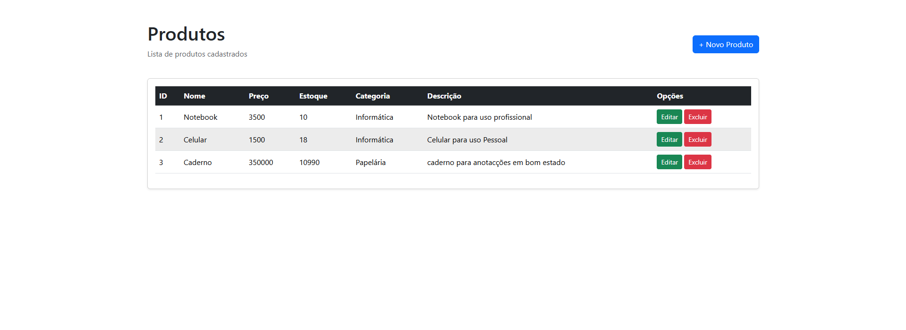
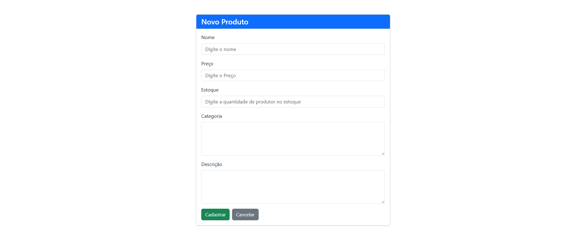
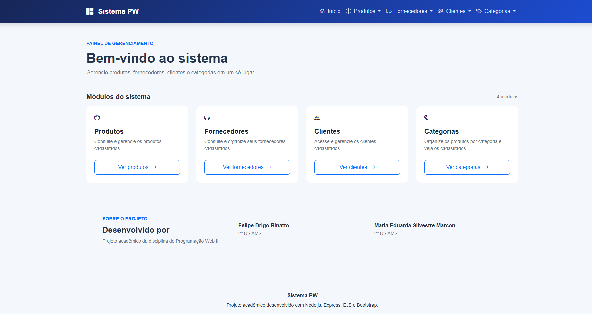
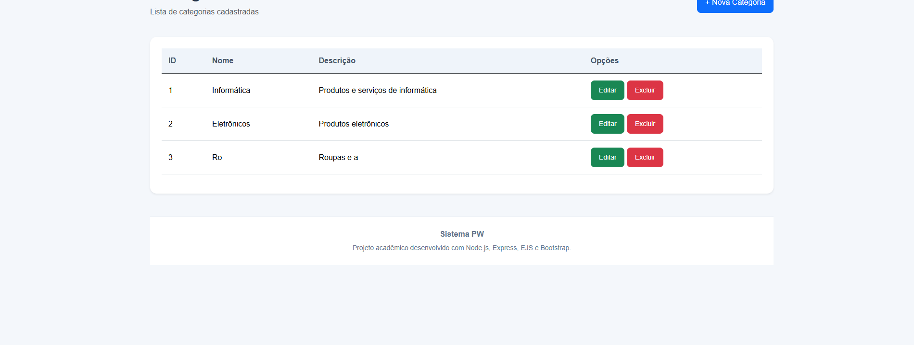

# Sistema de Gerenciamento

## 1. Nome do Projeto

**Sistema de Gerenciamneto ejs**

## 2. Integrantes

- Maria Eduarda Silvestre Marcon
- Felipe Drigo Binatto

## 3. Objetivo

O objetivo deste projeto é desenvolver um sistema de gerenciamento que permita realizar operações de cadastro, consulta, edição e exclusão de registros, facilitando a organização e a administração das informações.

O projeto também busca aplicar conhecimentos de desenvolvimento web, estruturação de páginas, estilização com CSS e integração entre os componentes da aplicação.

Durante o desenvolvimento, o grupo foi responsável pela construção das funcionalidades do sistema e utilizou a Inteligência Artificial como ferramenta de apoio para melhorar o design e a apresentação visual da interface.

## 4. Tecnologias Utilizadas

- **HTML:** estruturação das páginas da aplicação.
- **CSS:** estilização e personalização visual da interface.
- **Bootstrap:** utilização de componentes visuais, caso aplicável.
- **JavaScript:** implementação de interatividade, caso utilizado.
- **Node.js:** processamento das operações do sistema.
- **Git e GitHub:** controle de versão e hospedagem do código.
- **ChatGPT:** apoio na elaboração e melhoria dos estilos CSS.

## 5. Funcionalidades

O sistema implementa as operações CRUD:

- **Create (Criar):** cadastro de novos registros.
- **Read (Consultar):** visualização e listagem dos registros existentes.
- **Update (Atualizar):** edição de informações cadastradas.
- **Delete (Excluir):** exclusão de registros.

O desenvolvimento do CRUD foi realizado integralmente pelo grupo, incluindo a implementação das funcionalidades e da lógica necessária ao funcionamento do sistema.

## 6. Prompt Utilizado

Para melhorar a aparência visual do sistema, foi elaborado um prompt solicitando à Inteligência Artificial sugestões de estilização em CSS.

### Prompt enviado à IA

> Olá, Chat! Estamos desenvolvendo um sistema e gostaríamos de melhorar o design das páginas utilizando CSS. Queremos deixar a interface mais moderna, organizada e profissional, sem prejudicar as funcionalidades existentes.

Nosso sistema possui barra de navegação, formulários, cartões, tabelas, botões e rodapé. Você pode nos ajudar a criar um CSS que padronize esses elementos, utilizando tons de azul, fundo claro, cantos arredondados e uma aparência mais agradável?

> Queremos que a barra de navegação tenha um gradiente azul, que os formulários tenham campos mais bonitos, que os cartões tenham cantos arredondados e que os botões e as tabelas sigam o mesmo padrão visual. Também precisamos melhorar o rodapé e a visualização em dispositivos móveis.

## 7. Uso da Inteligência Artificial

A Inteligência Artificial foi utilizada como ferramenta de apoio no processo de melhoria visual do sistema, principalmente na elaboração do CSS.

O grupo solicitou auxílio ao ChatGPT para desenvolver uma identidade visual mais moderna e consistente, buscando melhorar a apresentação dos componentes e a experiência de utilização da aplicação.

A IA forneceu estilos para a barra de navegação, os menus suspensos, os cartões, os formulários, os botões, as tabelas e o rodapé, além de regras para adaptar determinados elementos a dispositivos móveis.

A maior parte do CSS de estilização foi elaborada com o auxílio da IA. Posteriormente, os integrantes revisaram o código, realizaram correções manuais em alguns pontos e adaptaram os estilos às necessidades do projeto.

É importante destacar que a utilização da IA ficou concentrada na parte visual da aplicação. **A implementação do CRUD e de sua lógica funcional foi realizada pelo próprio grupo.**

## 8. Alterações Sugeridas pela IA

As principais sugestões de melhorias visuais foram:

- **Fundo geral:** utilização de uma cor clara para melhorar o conforto visual.
- **Paleta de cores:** adoção de tons de azul como identidade visual do sistema.
- **Barra de navegação:** aplicação de gradiente azul, sombras suaves e efeitos de interação nos links.
- **Menus suspensos:** utilização de bordas arredondadas, espaçamentos e sombras.
- **Cartões:** padronização dos cantos arredondados e dos espaçamentos internos.
- **Formulários:** melhoria da aparência dos campos, rótulos, bordas e indicadores de foco.
- **Botões:** padronização do formato e dos espaçamentos.
- **Tabelas:** destaque para os cabeçalhos e melhoria da legibilidade das informações.
- **Rodapé:** utilização de cores neutras e borda superior discreta.
- **Responsividade:** inclusão de regras CSS para melhorar a apresentação em telas menores.
- **Organização visual:** utilização de classes específicas para determinados componentes e páginas.

Essas sugestões serviram como base para a estilização visual aplicada ao sistema.

## 9. Alterações Implementadas pelo Grupo

O grupo foi responsável pelo desenvolvimento da aplicação e pela integração dos componentes necessários ao seu funcionamento.

### 9.1. Desenvolvimento realizado pelo grupo

- Implementação das operações de cadastro, consulta, edição e exclusão.
- Desenvolvimento da lógica funcional do sistema.
- Construção e integração das páginas necessárias às operações do CRUD.
- Ajustes e correções relacionados ao funcionamento da aplicação.
- Verificação do comportamento dos componentes durante o desenvolvimento.

### 9.2. Alterações manuais no CSS

Após receber o CSS elaborado com auxílio da IA, os integrantes revisaram o código e corrigiram alguns pontos para melhorar sua compatibilidade com o projeto.

Essas intervenções tiveram como objetivo adaptar os estilos às páginas existentes, corrigir inconsistências visuais identificadas e garantir que os componentes continuassem funcionando adequadamente.

A maior parte da estilização foi produzida com o auxílio da IA, enquanto as correções pontuais e adaptações necessárias foram realizadas manualmente pelo grupo.

### 9.3. Resumo da participação

| Etapa | Responsável | Descrição |
|---|---|---|
| Desenvolvimento do CRUD | Grupo | Implementação das operações e da lógica funcional do sistema. |
| Estruturação e integração das funcionalidades | Grupo | Construção das páginas e integração dos componentes. |
| Elaboração da maior parte do CSS | IA, como ferramenta de apoio | Sugestões e código de estilização para padronizar a interface. |
| Revisão e correções pontuais do CSS | Grupo | Ajustes manuais para adequar os estilos ao projeto. |
| Validação das alterações | Grupo | Verificação do comportamento do sistema após as modificações. |

## 10. Prints da Conversa com a IA

Nesta seção serão apresentadas as evidências da utilização da Inteligência Artificial durante o processo de estilização.

### 10.1. Prompt enviado

Registro da solicitação realizada ao ChatGPT para obter auxílio na melhoria visual do sistema.

### 10.2. Resposta da IA com o CSS

Registro da resposta contendo as sugestões de estilização para os componentes da interface.

## 11. Antes da Reestilização

Nesta seção será apresentada a interface original do sistema, antes da aplicação das melhorias visuais.

**Descrição:** captura de tela da interface original, utilizada como referência para comparação com a versão reestilizada.

## 12. Depois da Reestilização

Nesta seção será apresentada a interface após a aplicação das melhorias visuais.

**Descrição:** captura de tela da interface após a aplicação dos estilos CSS, destacando as alterações visuais realizadas.

### Comparação dos resultados

A comparação entre as duas versões permite observar as mudanças na apresentação visual do sistema. As melhorias podem ser avaliadas considerando a padronização dos componentes, a organização dos elementos, a legibilidade e a adaptação a diferentes tamanhos de tela.

O objetivo da reestilização foi aprimorar a experiência visual sem comprometer as funcionalidades desenvolvidas pelo grupo.

## 13. Link da Aplicação

[**Acessar a aplicação**](https://nodejs-navega-o-ejs.onrender.com/)

## 14. Link do Repositório

[**Acessar o repositório no GitHub**](https://github.com/FelipeBinatto/NodeJS---navega-o-EJS.git)

---

## Considerações finais

O projeto permitiu ao grupo aplicar conhecimentos de desenvolvimento de sistemas por meio da implementação do CRUD e da integração das funcionalidades da aplicação.

A Inteligência Artificial foi utilizada como ferramenta complementar para apoiar a estilização CSS, enquanto os integrantes permaneceram responsáveis pela lógica funcional, pela revisão do código visual e pelas correções manuais necessárias.

Dessa forma, o trabalho documenta a utilização da IA como apoio ao desenvolvimento e destaca a participação do grupo na construção e validação do sistema.
